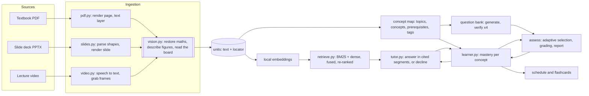

# Architecture

Pramana is one Python package, one SQLite file per course, and a browser app with no build
step. This page says what each part does and why it is built that way.

## The unit: the smallest citable piece

Everything rests on one table, `units`. A unit is a passage, a figure, a slide, a spoken
passage of a lecture, or a reading of the board at one moment. Each carries a `locator`:

| Source | Locator | What a citation opens |
|---|---|---|
| Textbook passage | `{"page": 216, "rect": [x0, y0, x1, y1]}` | the page image with the passage outlined |
| Textbook figure | `{"page": 215, "label": "Figure 5.10", "rect": [...]}` | the page with the figure outlined |
| Slide | `{"slide": 13}` | the rendered slide |
| Spoken passage | `{"t_start": 133.2, "t_end": 177.9}` | the video, seeked to the first word |
| Board reading | `{"t_frame": 177.4, ...}` | the video, a few seconds before the frame |

A unit never crosses a page, a slide or a passage boundary, so a citation is always one
place. Unit ids are derived from the location (`textbook:p216:2`, `slides-ch5:s13`,
`v-l04v01:t133`), which keeps them stable across re-ingestion: questions, test sets and
caches that refer to a unit keep working.

## Ingestion

**Why vision is in the main path.** In the OpenStax PDF every equation is drawn as vector
graphics. The text layer of a page reads *"the average and instantaneous accelerations are
equal—that is,"* and then nothing. The slide decks keep equations as Office Math inside
`mc:AlternateContent` blocks that python-pptx skips. The lecturer writes on a board and says
"this" while pointing. A pipeline that reads only text would hold a physics course with no
formulas in it. So each page, each slide that carries a picture or an equation, and one
frame per spoken passage is read by a vision-language model:

* `pdf.py` renders the page, extracts the text layer, and gives both to the model. The text
  layer anchors the wording (so prose is copied, not paraphrased) and the image supplies
  what the text layer lacks. The model returns ordered blocks: headings, paragraphs with
  inline LaTeX, displayed equations, figures with a bounding box and a description.
  Highlight rectangles for prose come from the PDF's own character boxes, not from the
  model; figure boxes are snapped to the bounds of the embedded images when they overlap.
* `slides.py` parses the deck itself (including the `AlternateContent` blocks and their
  fallback pictures), draws a preview with Pillow, and asks the model for the equations and
  a description of the picture. No office suite is needed.
* `video.py` transcribes with faster-whisper (word timestamps), groups words into passages
  of about 40 seconds that end on sentence boundaries, and takes one frame at the end of
  each passage, when the board is fullest. The spoken passage and the board reading are two
  units that point at each other, and retrieval returns them together.

End-of-chapter exercise lists are detected from the text layer and skipped: they are not
teaching material and would attract citations.

**Concept map.** One model call turns the outline of all sources into topics, concepts and
prerequisite edges. Code then enforces what the prompt can only ask for: unknown references
are dropped and an edge may only point backwards in teaching order, so the result is a DAG.
Units are tagged in batches; embeddings shortlist six candidate concepts per unit and a
model picks one or two.

## Retrieval

About a thousand units fit in memory, so search is exact: BM25 and cosine similarity over
`bge-small-en-v1.5` vectors, fused by reciprocal rank, then re-ranked by a cross-encoder.
Embeddings and re-ranking run locally on CPU. There is no vector database because nothing
at this size needs one, and exact search keeps results reproducible.

## The tutor

See [grounding.md](grounding.md). In short: the model answers in segments that each name
their sources; code removes any segment without a valid source; when nothing supports an
answer the tutor declines and points to the nearest material.

## Assessment and the learner model

See [learner-model.md](learner-model.md). Questions are generated per concept from that
concept's units and enter the bank only after four checks. The selector picks the next
question from the learner model's state; every answer and every conversation updates it.

## Model access

`llm.py` is the only module that talks to a language model. It speaks the OpenAI chat
protocol, so the endpoint can be Gemini, OpenAI, a local Ollama or vLLM server, or any
router. Three properties matter:

* **Replay.** Every reply is appended to `data/llm_cache/<namespace>.jsonl`. With
  `PRAMANA_LLM_MODE=replay` nothing touches the network and the knowledge base, the
  question bank and the evaluation rebuild from the committed cache. Calls that embed
  rendered images are keyed on (prompt version, source-file hash, position) rather than on
  image bytes, so a replay works on a machine whose JPEG encoder differs.
* **Fallback chains.** Each role (author, tutor, verifier, judge, vision, bulk) is a list of
  models in order of preference. A rate-limited model is put on cool-down for as long as
  the server asks, and the request moves down the chain. [results.md](results.md) ends with
  a table of which model actually wrote each stage's replies.
* **Roles are split by what they need.** The larger models write the concept map and the
  questions (low volume, quality matters). A small fast model does vision, tagging and
  tutoring. Two roles exist to keep a model from marking its own work: the verifier is
  never the model that wrote the question, and the evaluation's judge is not the model
  that wrote the tutor's answers.
* **Nothing stale in the cache.** With `PRAMANA_CACHE_TRACE=<file>` a run records every
  request it makes, and `scripts/prune_cache.py` drops cached replies that no current code
  path asks for, so the committed cache is exactly what a replay reads.

## Storage

One SQLite database per course holds the knowledge base, the question bank and all learner
state (`db.py` has the schema). It is a single file a student could carry between
machines, and it makes the evaluation's "copy the course, simulate 720 students, throw the
copy away" a three-line operation.

## Web app

`web/` is plain ES modules, served as static files by the same FastAPI process. There is no
bundler and no framework; `core.js` has a 20-line element builder and a safe renderer for
text with LaTeX (KaTeX, vendored). The trade-off is deliberate: `pramana serve` is the
whole deployment, and there is nothing to build before the app can be judged.

| View | What it shows |
|---|---|
| Tutor | conversation, numbered citations, the source viewer |
| Practice | diagnostic, adaptive quiz, mock exam, cited feedback, report |
| Progress | mastery per concept, the evidence log, study schedule, flashcards |
| Course map | topics, concepts and prerequisites coloured by mastery |
| Library | sources, how each unit was read, upload |
| Evidence | the evaluation's results, read from `evaluation/results/*.json` |
